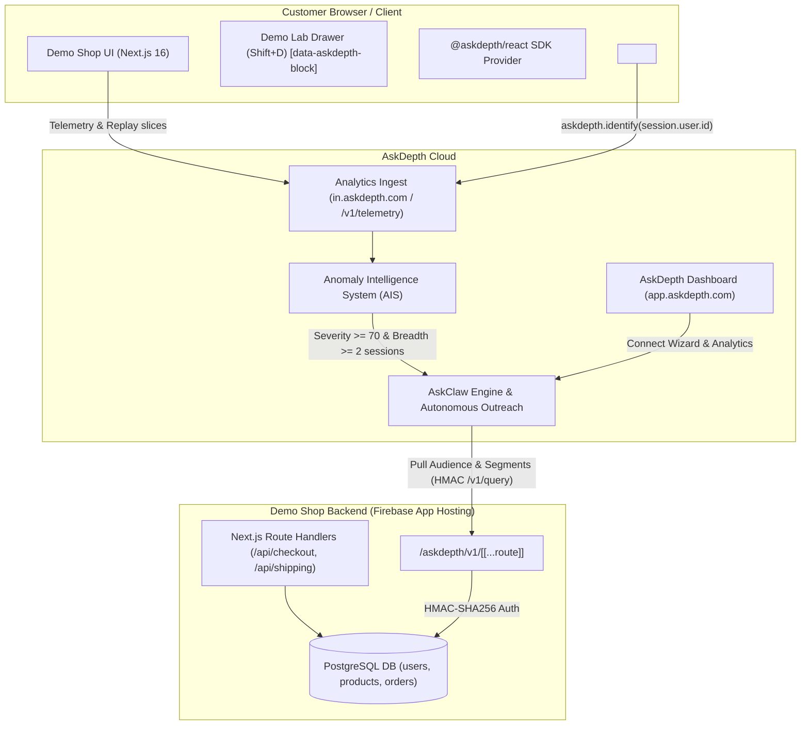

# AskDepth Demo Shop — Complete Showcase & Onboarding Playbook

An interactive demonstration e-commerce storefront for **Demo Shop** (`demo-shop.askdepth.com`), integrated with the AskDepth ecosystem:
- **AskDepth SDK (`@askdepth/react`, `@askdepth/core`, `@askdepth/replay`, `@askdepth/contracts`)**: behavioural anomaly detection (`RAGE_CLICK`, `DEAD_CLICK`, `ERROR_CLICK`), W3C `traceparent` propagation, session replay with zero-PII masking.
- **Babel/Turbopack Source Mapping Plugin**: automatic runtime mapping of React Fiber components to Git repository source files and line numbers (`cmp_xxxxxxxx` -> `components/checkout/checkout-form.tsx:142:5`).
- **Audience Connector (`@askdepth/audience-connector`)**: bi-directional HMAC-authenticated connector to the store's user database served at `/askdepth/v1/*` for segmentation, cohort extraction, and AskClaw interviews.
- **Interactive Demo Lab Drawer (Shift + D)**: 1-click bug toggles, shopper persona switching, AIS cohort wave simulation, and SDK hot-connect override.

---

## 1. Integration Architecture



---

## 2. Domains and Email Delivery Clarifications

### Why is `askdepth.com` blocked in the UI?
1. **In Audience Setup (Step 8: Sending Domain):**
   In AskDepth codebase (`packages/shared/src/outreach/sending-domain-provider.ts`):
   ```typescript
   export function validateSendingSubdomain(subdomain: string): void {
     if (isProduction && (domain.endsWith('.askdepth.com') || domain.endsWith('.askdepth.io'))) {
       throw new Error('ASKDEPTH_DOMAIN: The askdepth domain cannot be claimed as a customer sending domain');
     }
   }
   ```
   **This is a safeguard:** a customer workspace cannot claim `@askdepth.com` as their own custom **sender domain** (`From:`).
   - In the Outreach setup wizard, configure your custom verified sending domain (e.g. `mail.yourdomain.com`) or use the default platform pool for evaluation.
   - **Email recipients (`To:`) are NOT blocked!** Outreach emails can be delivered to any address, including `founder@gmail.com`, `admin@askdepth.com`, or via `+aliases`: `founder+sarah@gmail.com`, `founder+marcus@gmail.com`.

2. **In Firebase Custom Domain Settings (from screenshot):**
   In the `Add custom domain` dialog for `www.askdepth.com`:
   - Checkbox **`Redirect www.askdepth.com to an existing website`** -> **must be checked** and redirected to `askdepth.com`.
   - This maintains standard SEO best practices: `https://askdepth.com` is the canonical apex landing domain, and `www.` issues a permanent 301 redirect.

---

## 3. Step-by-Step Smoke Test Onboarding Playbook (Live Cloud Run)

### Step 1. Account Creation and Workspace Entitlements
1. Navigate to the web application at `https://app.askdepth.com` (or your staging instance).
2. Register an owner account (e.g., `artem@...`).
3. To access autonomous AskClaw interviews and capabilities, access the super-admin console (`/admin`) and grant the workspace the **PRO** plan along with interview credits via `admin-gifts.service.ts`.

### Step 2. Analytics Project and SDK Key Creation
1. In the sidebar, navigate to **Settings -> Analytics Projects** -> **Create Project**.
2. Enter the project name: `demo-shop`.
3. Copy the generated credentials:
   - **Browser Write Key** (`ad_bw_...`) — public key used by the client-side browser SDK.
   - **Deploy Token** (`ad_dep_...`) — secret token used to upload component maps during CI/CD build.
4. Verify `ALLOWED_ORIGINS` in your `analytics-ingest` service: ensure `https://demo-shop.askdepth.com` is whitelisted in CORS (or configured as `*`).

### Step 3. Configure Secrets in Firebase App Hosting
Execute the following commands to configure production secrets for the Demo Shop backend:

```bash
# 1. Browser telemetry write key
firebase apphosting:secrets:set NEXT_PUBLIC_ASKDEPTH_WRITE_KEY
# (paste value: ad_bw_...)

# 2. Deploy token for component map upload
firebase apphosting:secrets:set ASKDEPTH_DEPLOY_TOKEN
# (paste value: ad_dep_...)

# 3. Grant App Hosting backend access to secrets:
firebase apphosting:secrets:grantaccess NEXT_PUBLIC_ASKDEPTH_WRITE_KEY --backend <BACKEND_NAME>
firebase apphosting:secrets:grantaccess ASKDEPTH_DEPLOY_TOKEN --backend <BACKEND_NAME>
```

> **Tip for immediate testing without redeployment:**  
> Open Demo Shop in your browser, press `Shift + D` -> open the **Status** tab -> paste your `ad_bw_...` key into the **"Browser SDK Hot-Connect Override"** input -> click **"Apply in Browser"**. The SDK will activate immediately!

### Step 4. Audience Connector Setup (11-Step Wizard)
1. In AskDepth, go to **Audience** -> **Connect Data Source** -> select **Custom / Audience Connector**.
2. **Step 1: Endpoint URL:**  
   Specify URL: `https://demo-shop.askdepth.com/askdepth/v1`
3. **Step 2: Shared Secret (HMAC Secret):**  
   AskDepth generates a 64-hexadecimal key.  
   Set it in Demo Shop App Hosting secrets:
   ```bash
   firebase apphosting:secrets:set ASKDEPTH_CONNECTOR_SECRET
   firebase apphosting:secrets:grantaccess ASKDEPTH_CONNECTOR_SECRET --backend <BACKEND_NAME>
   ```
4. **Steps 3–7: Database Field Mapping:**
   | AskDepth Field | Demo Shop DB Column | Data Type | Purpose |
   |---|---|---|---|
   | **External ID** | `id` | `string` | Primary shopper ID (`cust_hero_sarah`, CUID) |
   | **Email** | `email` | `string` | Customer contact email |
   | **Name** | `name` | `string` | Customer full name |
   | **Marketing Opt-In** | `marketing_opt_in` | `boolean` | Consent for outreach communications |
   | **Is Active** | `is_active` | `boolean` | Account activity flag |
   | **Segment** | `segment` | `string` | `vip`, `cart_abandoner`, `repeat_buyer`, `new_customer`, `at_risk` |
   | **Loyalty Tier** | `loyalty_tier` | `string` | `platinum`, `gold`, `silver`, `standard` |
   | **Preferred Category** | `preferred_category` | `string` | `electronics`, `clothing`, `home-garden` |
   | **Device Type** | `device_type` | `string` | `desktop`, `mobile`, `tablet` |
   | **Abandoned Cart** | `has_abandoned_cart` | `boolean` | Cart abandonment indicator |
   | **Created At** | `created_at` | `timestamptz` | Registration timestamp |
   | **Country** | `country` | `string` | **Filter-only** (usable in criteria, omitted from row payload) |
5. **Step 8: Security & Unmapped Columns:**
   Columns `password` and `internal_notes` remain **unmapped** — the connector strictly excludes them from queries, satisfying security case N3.
6. Complete the wizard: AskDepth will execute an automated handshake and contract conformance verification.

---

## 4. Interactive Showcase Guide (5-Minute Prospect Demo Script)

Use the floating **Demo Lab** panel (`🧪 Demo Lab` pill in the bottom-right corner or keyboard shortcut `Shift + D`) to demonstrate friction capture and autonomous resolution live.

### Scenario 1. Promo Code Rage Click (`RAGE_CLICK`)
- **Customer Problem:** Shopper tries to apply a promotional code, clicks "Apply", but the button silently swallows clicks without response.
- **How to demonstrate:**
  1. In Demo Lab, toggle **"Promo Code Silent Hang"** ON.
  2. Navigate to `/cart` or `/checkout`.
  3. In the promo code box, enter `WELCOME20` and click **"Apply"** rapidly 3–4 times.
  4. The `@askdepth/core` detector records a `RAGE_CLICK` (>= 3 clicks within 1500 ms in a 30 px radius), attributes it to the `PromoCodeBox` component, and uploads a session replay slice to AskDepth.

### Scenario 2. Dead Click on Product Detail Page (`DEAD_CLICK`)
- **Customer Problem:** Button appears clickable (`cursor: pointer`), but produces no action (>800 ms with zero DOM mutation, URL change, or network activity).
- **How to demonstrate:**
  1. In Demo Lab, toggle **"Broken Size Guide & Store Pickup"** ON.
  2. Open any product page (e.g., `/products/premium-cotton-tshirt`).
  3. Click **"Size & Fit Guide"** or **"Check Store Pickup"**.
  4. The detector logs a `DEAD_CLICK` along with `computed_styles` and component selector `ProductInteractiveTools`.

### Scenario 3. Shipping Gateway 503 Outage (`ERROR_CLICK` Network)
- **Customer Problem:** When selecting express shipping, the third-party carrier rate service returns HTTP 503.
- **How to demonstrate:**
  1. In Demo Lab, toggle **"Express Shipping / Gateway 503"** ON.
  2. Navigate to `/checkout`.
  3. Select **"Express Delivery"** or **"Overnight Shipping"**.
  4. A request is made to `POST /api/shipping/quote` -> fails with HTTP 503. The detector correlates the network error with the user's click within the 10-second correlation window, attaching the W3C `traceparent`.

### Scenario 4. Component Render Crash in React Error Boundary (`ERROR_CLICK` Component Catch)
- **Customer Problem:** When customizing an electronics protection bundle, an unhandled `TypeError` crashes rendering.
- **How to demonstrate:**
  1. In Demo Lab, toggle **"Bundle Configurator Render Crash"** ON.
  2. Open an electronics product (e.g., `/products/iphone-15-pro`).
  3. In the **Protection & Accessory Bundle** widget, click *"2-Year Care+ Plan"*.
  4. The exception is intercepted cleanly by `<AskdepthCatch>`, displaying a resilient fallback UI with a recovery button while sending the React Fiber component stack and replay buffer to AskDepth.

### Scenario 5. A/B Experiment Regression (Cohort `stepped_v2`)
- **Customer Problem:** A multi-step checkout variant introduces elevated P95 latency (>1.5 s) and friction.
- **How to demonstrate:**
  1. In Demo Lab, toggle **"Checkout v2 Experiment Regression"** ON.
  2. Navigate to `/checkout`. An active badge indicates the `stepped_v2` experiment.
  3. All telemetry events are automatically tagged with `feature_flag="checkout_v2"` and `experiment_variant="stepped_v2"`, allowing AskClaw to isolate the regression to this specific cohort.

### Scenario 6. Zero-PII Masking in Session Replay
- **Key selling point for prospects:**
  1. On the `/checkout` page, inspect the privacy badges.
  2. Customer address and contact inputs are marked with `data-askdepth-mask` — characters appear masked (`***`) in session recordings.
  3. The mock payment card block and Demo Lab panel are marked with `data-askdepth-block` — DOM nodes inside are completely omitted from the recording.

### Scenario 7. Instant Cohort Wave Simulation ("AIS Wave")
- **Purpose:** AskDepth's Anomaly Intelligence System (AIS) filters out single-user anomalies and triggers incident investigation only when breadth and volume gates are satisfied (≥2–3 distinct sessions, AIS severity score ≥ 70).
- **How to trigger:**
  1. Open the **"AIS Wave"** tab in Demo Lab.
  2. Select an incident type (e.g., *Checkout Express Shipping 503*).
  3. Click **"Simulate 7-Shopper Incident Wave"**.
  4. The Demo Shop backend dispatches a burst of valid telemetry envelopes across 7 customer accounts (`Sarah Chen`, `Marcus Rivera`, `Elena Kowalski`, and synthetic users), linking them via `external_id`.
  5. In AskDepth, the anomaly immediately passes the AIS promotion threshold and AskClaw begins autonomous root-cause research and interview synthesis!

---

## 5. Shopper Personas for 1-Click Login

The **Shoppers** tab in Demo Lab (and the quick-login section on `/auth/signin`) provides immediate 1-click persona switching:

| Name | Segment | Badge | Demo Role |
|---|---|---|---|
| **Sarah Chen** | `vip` | VIP · Platinum | Loyal VIP ($4.8k LTV). Validates bundle configurator and express shipping. |
| **Marcus Rivera** | `cart_abandoner` | Cart Abandoner · Gold | Active $1,229 cart. Demonstrates promo code rage click and shipping 503. |
| **Elena Kowalski** | `new_customer` | New Customer | First apparel visit. Triggers dead click on size guide. |
| **Alex Mercer** | `at_risk` | At-Risk · Refunded | Churned customer with prior refund. Target for AskClaw retention interviews. |
| **John Doe** | `repeat_buyer` | Repeat Buyer | Standard returning buyer for baseline cart workflows. |
| **Guest** | — | Anonymous Guest | Quick session clear to test anonymous guest behavior. |

Default password for all demo personas: `customer123`.

---

## 6. Local Development and Database Reseeding

To run locally or re-seed your PostgreSQL database:

```bash
# 1. Generate Prisma Client
npm run db:generate

# 2. Push schema to local PostgreSQL
npm run db:push

# 3. Seed 16 products, 5 hero personas, and 900 synthetic customers
npm run db:seed

# (Optional) Provide a base email to route all hero persona notifications via +aliases
DEMO_INBOX_EMAIL="founder@yourdomain.com" npm run db:seed

# 4. Type check and production build
npm run type-check
npm run build

# 5. Start development server
npm run dev
```
